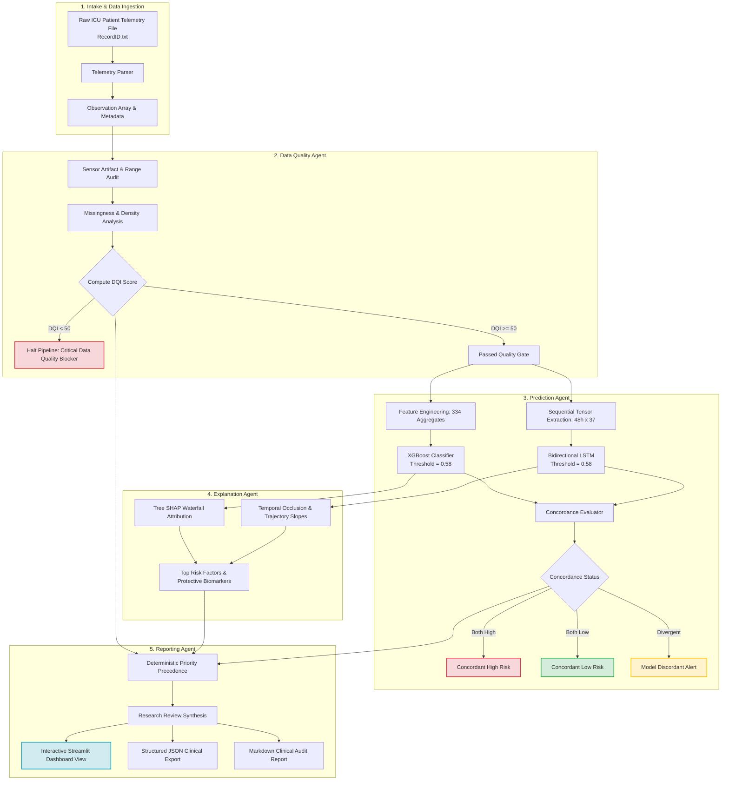

# Agentic AI-Assisted ICU Mortality Risk Prediction from the First 48 Hours

[](https://www.python.org/)
[](https://streamlit.io/)
[](https://xgboost.readthedocs.io/)
[-red.svg)](https://keras.io/)
[](https://shap.readthedocs.io/)
[]()
[](LICENSE)

> **CRITICAL MEDICAL & RESEARCH DISCLAIMER**  
> *Educational and research prototype only. Strictly not for direct clinical diagnosis or therapeutic decision-making.*  
> This software system represents an academic clinical machine learning and agentic decision-support investigation developed using the retrospective PhysioNet/Computing in Cardiology Challenge 2012 ICU dataset. Model outputs represent retrospective statistical risk associations and algorithmic estimations, not clinical diagnoses or clinical certainty. All outputs require review by licensed healthcare professionals.

---

## Table of Contents
1. [Project Overview](#1-project-overview)
2. [Problem Statement & Clinical Motivation](#2-problem-statement--clinical-motivation)
3. [Project Objectives](#3-project-objectives)
4. [Dataset Description](#4-dataset-description)
5. [Technology Stack](#5-technology-stack)
6. [Predictive Modeling Architectures](#6-predictive-modeling-architectures)
7. [Benchmark Model Comparison](#7-benchmark-model-comparison)
8. [Four-Agent Architecture](#8-four-agent-architecture)
9. [System Architecture & Workflow Diagram](#9-system-architecture--workflow-diagram)
10. [Explainability Methods](#10-explainability-methods)
11. [Streamlit Interactive Dashboard](#11-streamlit-interactive-dashboard)
12. [Project Folder Structure](#12-project-folder-structure)
13. [Installation & Setup](#13-installation--setup)
14. [Dataset Setup Instructions](#14-dataset-setup-instructions)
15. [Model Checkpoint & Artifact Setup](#15-model-checkpoint--artifact-setup)
16. [How to Run the Application](#16-how-to-run-the-application)
17. [Running the Automated Test Suite](#17-running-the-automated-test-suite)
18. [Clinical Limitations & Safety Guardrails](#18-clinical-limitations--safety-guardrails)

---

## 1. Project Overview

Early risk stratification of critically ill patients admitted to the Intensive Care Unit (ICU) is crucial for timely therapeutic interventions, proactive critical care escalation, and equitable allocation of life-support infrastructure. During the first 48 hours of ICU admission, clinicians encounter vast volumes of irregular, sparse, and high-velocity physiological time-series data from monitors and laboratory assays.

**Agentic AI-Assisted ICU Mortality Risk Prediction** provides an end-to-end clinical machine learning framework that marries:
- **Longitudinal Deep Sequence Modeling:** Bidirectional LSTM, Simple RNN, and 1D CNN networks operating on multivariate 48-hour physiological trajectories.
- **High-Dimensional Gradient Boosting:** Extreme Gradient Boosting (XGBoost) trained on 334 granular tabular aggregation features.
- **Rigorous Local Explainability:** Exact Tree SHAP (SHapley Additive exPlanations) attributions and temporal sequence occlusion.
- **Collaborative 4-Tier Agentic Governance:** Specialized autonomous agents for **Data Quality Auditing**, **Dual Model Inference**, **Feature & Temporal Explainability**, and **Deterministic Clinical Reporting**.
- **Healthcare-Grade Streamlit Interface:** Interactive clinician dashboard with real-time telemetry upload, trajectory plotting, and standardized research report export.

---

## 2. Problem Statement & Clinical Motivation

Intensive Care Units generate complex electronic health records (EHRs) characterized by:
1. **Irregular Sampling Intervals:** Vital signs are recorded intermittently, while laboratory blood analyses occur sporadically.
2. **Extreme Missingness:** Over 75% of physiological observation cells are typically missing or unmeasured.
3. **Complex Nonlinear Interactions:** Acute physiological decompensation (e.g., septic shock, acute respiratory distress, multiorgan dysfunction) involves multi-system cascading failures.
4. **Black-Box Skepticism:** Deep neural networks and ensemble trees lack transparent interpretability, creating adoption hurdles for critical care teams.
5. **Data Quality Hazards:** Sensor detachment, motion artifacts, and erroneous entry can corrupt predictive pipelines if not aggressively audited prior to inference.

This project addresses these challenges directly through rigorous zero-leakage preprocessing, dual model concordance evaluation, transparent SHAP explanations, and automated data quality gating.

---

## 3. Project Objectives

- **Develop and Benchmark Diverse ML/DL Models:** Implement and compare XGBoost, 1D CNN, Simple RNN, and Bidirectional LSTM architectures for ICU mortality prediction at both 24-hour and 48-hour horizons.
- **Prevent Data Leakage:** Ensure zero information leakage across cross-validation and held-out test splits through strict split-isolated imputation and scaling.
- **Implement an Autonomous 4-Agent Architecture:** Build distinct agents with single responsibilities governed by a deterministic priority hierarchy to prevent unchecked hallucinations.
- **Provide Granular Local Explainability:** Break down patient risk scores into positive (risk-elevating) and negative (protective) physiological drivers with Tree SHAP and temporal sensitivity curves.
- **Deliver a Production-Ready Interface:** Provide a responsive Streamlit dashboard supporting custom patient telemetry file uploads, demo cohort inspection, and auditable JSON/Markdown reporting.

---

## 4. Dataset Description

The models are trained, validated, and evaluated on the **PhysioNet / Computing in Cardiology Challenge 2012** benchmark dataset (*Predicting Mortality of an In-Hospital ICU Population*):

- **Total Patient Population:** 12,000 adult ICU records across 4 ICU types (Coronary Care, Cardiac Surgery Recovery, Medical ICU, Surgical ICU).
- **Observation Window:** The first 48 hours of ICU stay.
- **Target Outcome:** Retrospective in-hospital mortality (`In-hospital_death` $\in \{0, 1\}$).
- **Data Partitions:**
  - **Set A (4,000 records, ID 132539–142673):** Used for 5-fold stratified cross-validation and hyperparameter tuning with `Outcomes-a.txt`.
  - **Set B (4,000 records, ID 142675–152864):** Held-out retrospective validation benchmark with `Outcomes-b.txt`.
  - **Set C (4,000 records, ID 152871–163037):** Held-out external generalization benchmark with `Outcomes-c.txt`.
- **Variables Recorded:**
  - **5 Static Descriptors:** `RecordID`, `Age`, `Gender`, `Height`, `Weight`, `ICUType`.
  - **37 Time-Series Biomarkers:** Core vitals (`HR`, `SysABP`, `DiasABP`, `MAP`, `RespRate`, `Temp`, `SaO2`), neurological score (`GCS`), renal/metabolic markers (`Urine`, `BUN`, `Creatinine`, `Glucose`, `Na`, `K`), hematology (`WBC`, `Platelets`, `HCT`), and blood gases (`pH`, `PaO2`, `PaCO2`, `FiO2`, `Lactate`, `HCO3`).

---

## 5. Technology Stack

- **Dashboard & User Interface:** Streamlit (v1.61.1)
- **Interactive Visualization:** Plotly (v6.3.0), Matplotlib (v3.10.8), Seaborn (v0.13.2)
- **Gradient Boosting:** XGBoost (v3.4.1)
- **Deep Learning Framework:** Keras (v3.15.1 with PyTorch Backend), PyTorch (v2.13.0+cpu)
- **Model Explainability:** SHAP (v0.54.1 TreeExplainer)
- **Data Engineering & Scientific Computing:** NumPy (v2.3.5), Pandas (v2.3.3), Scikit-Learn (v1.8.0), Joblib (v1.5.2)
- **Automated Verification:** Python `unittest` suite (69 passing tests)

---

## 6. Predictive Modeling Architectures

Four distinct predictive modeling strategies were engineered and evaluated:

1. **XGBoost (Extreme Gradient Boosting):**
   - **Representation:** 334 aggregate tabular features (first, last, min, max, mean, standard deviation, and trajectory slope computed over 48-hour and 24-hour windows).
   - **Hyperparameters:** Depth-constrained decision trees regularized with scale-pos-weight handling class imbalance.
   - **Inference Speed:** Real-time (~2 milliseconds per patient).
2. **1D Convolutional Neural Network (1D CNN):**
   - **Representation:** Temporal tensor `(N, 48, 37)` or `(N, 24, 37)` with missingness indicator masks.
   - **Architecture:** Multi-scale 1D convolutional layers with batch normalization, ReLU activation, dropout (0.3), and global max-pooling.
   - **Parameters:** 49,249 trainable parameters.
3. **Simple Recurrent Neural Network (Simple RNN):**
   - **Representation:** Sequential time-series tensor with forward-filled physiological steps.
   - **Architecture:** Stacked recurrent layers with recurrent dropout to capture sequential dependencies across consecutive hours.
   - **Parameters:** 14,337 trainable parameters.
4. **Bidirectional Long Short-Term Memory (LSTM):**
   - **Representation:** 48-step and 24-step longitudinal tensors with dynamic physiological variables and static demographic embeddings.
   - **Architecture:** Bidirectional recurrent memory cells followed by dense projection layers, sigmoid classification head, and dropout regularization.
   - **Parameters:** 51,361 trainable parameters.

---

## 7. Benchmark Model Comparison

All models were evaluated under strict 5-fold cross-validation on Set A, with decision thresholds tuned strictly to maximize F1-score on validation folds, then evaluated on held-out Test Sets B and C:

| Model Architecture | Model Family | Horizon | Parameters | Optimal Threshold | Val AUROC | Val AUPRC | Val F1 | Test B AUROC | Test B AUPRC | Test B F1 | Test C AUROC | Test C AUPRC | Test C F1 |
| :--- | :--- | :---: | :---: | :---: | :---: | :---: | :---: | :---: | :---: | :---: | :---: | :---: | :---: |
| **XGBoost Baseline (48h FF)** | Gradient Boosted Trees | 48h | 334 Features | 0.58 | **0.8982** | **0.5901** | **0.5682** | **0.8651** | **0.5416** | **0.5291** | **0.8602** | **0.5496** | **0.5364** |
| **Simple RNN (48h FF)** | Recurrent Neural Net | 48h | 14,337 | 0.66 | 0.8756 | 0.5604 | 0.5556 | 0.8464 | 0.5137 | 0.5164 | 0.8370 | 0.4923 | 0.5048 |
| **Bidirectional LSTM (48h FF)** | Recurrent Neural Net | 48h | 51,361 | 0.58 | 0.8581 | 0.5231 | 0.5533 | 0.8341 | 0.4839 | 0.4887 | 0.8187 | 0.4590 | 0.4933 |
| **1D CNN (48h FF)** | Convolutional Neural Net| 48h | 49,249 | 0.47 | 0.8565 | 0.5677 | 0.5342 | 0.8226 | 0.4361 | 0.4737 | 0.8155 | 0.4452 | 0.4712 |
| **LSTM (48h Simple Imputation)**| Recurrent Neural Net | 48h | 51,361 | 0.69 | 0.8575 | 0.4915 | 0.5271 | 0.8373 | 0.4758 | 0.5146 | 0.8351 | 0.4708 | 0.5028 |
| **LSTM (24h Early Warning)** | Recurrent Neural Net | 24h | 51,361 | 0.66 | 0.8253 | 0.4434 | 0.5020 | 0.7866 | 0.3895 | 0.4191 | 0.7986 | 0.4101 | 0.4412 |

---

## 8. Four-Agent Architecture

The clinical intelligence pipeline is organized into four specialized agents adhering to strict separation of concerns and deterministic decision rules:

```
┌─────────────────────────────────────────────────────────────────────────────┐
│                          FOUR-AGENT ARCHITECTURE                            │
├─────────────────────┬─────────────────────┬───────────────────┬─────────────┤
│ 1. DATA QUALITY     │ 2. PREDICTION       │ 3. EXPLANATION    │ 4. REPORTING│
│    AGENT            │    AGENT            │    AGENT          │    AGENT    │
├─────────────────────┼─────────────────────┼───────────────────┼─────────────┤
│ • Static Audit      │ • Dual Inference    │ • Tree SHAP       │ • Synthesis │
│ • Artifact Detector │ • Threshold Check   │ • Risk Drivers    │ • Hierarchy │
│ • DQI Gate (0-100)  │ • Concordance Check │ • Protective Fact.│ • Export    │
│ • Outlier Filtering │ • No Averaging Rule │ • Temporal Window │ • Markdown  │
│ • Blocker if DQI<50 │ • Model Isolation   │ • Trend Slopes    │ • JSON      │
└─────────────────────┴─────────────────────┴───────────────────┴─────────────┘
```

1. **Data Quality Agent (`src/agents/data_quality_agent.py`):**
   - Audits completeness of general static descriptors (Height, Weight, Age, Gender, ICU Type).
   - Scans 37 time-series parameters for physical impossibility, transducer disconnections, and sensor artifacts while preserving genuine pathological extremes.
   - Computes the **Data Quality Index (DQI)** on a continuous $[0, 100]$ scale.
   - **Quality Gate:** If $\text{DQI} < 50$, downstream inference is automatically blocked to prevent unsafe predictions on corrupted inputs.
2. **Prediction Agent (`src/agents/prediction_agent.py`):**
   - Executes dual model inference using pre-trained frozen checkpoints:
     - **XGBoost:** Evaluates 334 tabular statistics against validation threshold `0.58`.
     - **Bidirectional LSTM:** Evaluates longitudinal temporal sequences against validation threshold `0.58` (48h) or `0.66` (24h).
   - Classifies inter-model concordance:
     - `MODEL_CONCORDANT_HIGH`: Both models predict elevated mortality risk.
     - `MODEL_CONCORDANT_LOW`: Both models predict low mortality risk.
     - `MODEL_DISCORDANT`: Disagreement between tabular and temporal representations.
   - **Strict Safety Constraint:** Prohibits probability averaging to preserve model independence and transparency.
3. **Explanation Agent (`src/agents/explanation_agent.py`):**
   - Computes local Shapley values via Tree SHAP, isolating top positive (risk-elevating) and top negative (protective) feature contributions.
   - Analyzes temporal dynamics across critical biomarker trajectories (HR, SysABP, GCS, BUN, Lactate, Urine, etc.).
   - Classifies biomarker trajectories as *Worsening*, *Improving*, or *Stable*.
4. **Reporting Agent (`src/agents/reporting_agent.py`):**
   - Aggregates upstream findings into structured clinical research summaries.
   - Applies deterministic priority precedence:
     1. $\text{DQI} < 50 \implies \text{CRITICAL\_DATA\_QUALITY}$ (Inference halted)
     2. $50 \le \text{DQI} < 70 \implies \text{MODERATE}$ (Caution: telemetry uncertainty)
     3. Model Discordance $\implies \text{MODERATE}$ (Review tabular vs. temporal divergence)
     4. Concordant High ($\text{DQI} \ge 70$) $\implies \text{HIGH}$ priority review
     5. Concordant Low ($\text{DQI} \ge 70$) $\implies \text{LOW}$ priority monitoring
   - Emits dual machine-readable JSON schemas and human-readable Markdown reports.

---

## 9. System Architecture & Workflow Diagram



---

## 10. Explainability Methods

To bridge the gap between black-box predictions and clinical trust, the system incorporates two complementary explainability techniques:

### 1. Tabular Tree SHAP (SHapley Additive exPlanations)
- **Engine:** `shap.TreeExplainer` applied to the 334-feature XGBoost model.
- **Output:** Exact additive Shapley values satisfying local accuracy, missingness, and consistency.
- **Visualization:** Interactive waterfall and bar charts depicting the baseline base value $E[f(X)]$, individual feature forces $f_i(x)$, and the final patient log-odds prediction.
- **Clinical Categorization:** Features are sorted into **Top Risk-Elevating Factors** (e.g., elevated BUN, low GCS, tachycardia) and **Top Protective Factors** (e.g., normal urine output, stable oxygen saturation).

### 2. Longitudinal Temporal Occlusion & Trend Analysis
- **Temporal Occlusion:** The 48-hour observation window is partitioned into four 12-hour quartiles ($Q_1: 0\text{--}12\text{h}$, $Q_2: 12\text{--}24\text{h}$, $Q_3: 24\text{--}36\text{h}$, $Q_4: 36\text{--}48\text{h}$). By systematically masking each segment, the agent quantifies which temporal window exerted the highest dynamic leverage on the LSTM's trajectory assessment.
- **Biomarker Trajectory Slopes:** Computes rate-of-change regressions across 9 vital biomarkers to detect clinical deterioration versus stabilization.

---

## 11. Streamlit Interactive Dashboard

The Streamlit web application (`app/streamlit_app.py`) provides a clean healthcare analytics interface organized into 7 multi-page modules:

1. **Dashboard Overview (`1_Dashboard_Overview.py`):** Retrospective cohort mortality metrics, ICU subtype distribution, observation density histograms, and global biomarker distributions.
2. **Patient Analysis (`2_Patient_Analysis.py`):** Real-time patient telemetry intake via file upload (`.txt`) or selection from a demonstration cohort, automated Data Quality Agent audit, and one-click multi-agent pipeline activation.
3. **Model Predictions (`3_Model_Predictions.py`):** Dual independent prediction cards for XGBoost and LSTM, decision threshold markers, model concordance badge, and historical calibration curves.
4. **Explainability (`4_Explainability.py`):** Interactive Plotly SHAP waterfall plots, tabular risk breakdown, and longitudinal physiological trajectory charts with normal physiological reference bands.
5. **Agentic AI Reports (`5_Agentic_AI_Reports.py`):** Clinical research review reports synthesized by the Reporting Agent with direct download links for `.md` and `.json` files.
6. **Model Performance (`6_Model_Performance.py`):** Retrospective benchmark comparison across XGBoost, CNN, Simple RNN, and LSTM, including interactive AUROC and AUPRC curves, confusion matrices, and 5-fold cross-validation metrics.
7. **About Project (`7_About_Project.py`):** Comprehensive project documentation, methodology notes, agent governance rules, and safety disclaimers.

---

## 12. Project Folder Structure

```text
D:\ICU_Prediction\
├── app\                                # Streamlit Web Dashboard
│   ├── streamlit_app.py                # Main Application Landing Page
│   ├── components\                     # Reusable UI Widgets
│   │   ├── charts.py                   # Plotly Interactive Trajectories & SHAP Charts
│   │   ├── metric_cards.py             # Healthcare Metric KPI Cards
│   │   ├── report_viewer.py            # Markdown & JSON Clinical Report Viewers
│   │   └── sidebar.py                  # Persistent Patient Status & Horizon Controls
│   └── pages\                          # 7 Multi-Page Application Modules
│       ├── 1_Dashboard_Overview.py
│       ├── 2_Patient_Analysis.py
│       ├── 3_Model_Predictions.py
│       ├── 4_Explainability.py
│       ├── 5_Agentic_AI_Reports.py
│       ├── 6_Model_Performance.py
│       └── 7_About_Project.py
├── src\                                # Core Python Source Package
│   ├── agents\                         # Specialized Autonomous Agent Implementations
│   │   ├── data_quality_agent.py       # Agent 1: Telemetry & DQI Quality Gate
│   │   ├── prediction_agent.py         # Agent 2: XGBoost & LSTM Dual Inference
│   │   ├── explanation_agent.py        # Agent 3: Tree SHAP & Temporal Occlusion
│   │   ├── reporting_agent.py          # Agent 4: Research Synthesis & Priority Precedence
│   │   └── __init__.py
│   ├── services\
│   │   ├── icu_workflow.py             # Master Pipeline Orchestration Service
│   │   └── __init__.py
│   ├── cnn_model.py                    # 1D CNN Architecture & PyTorch/Keras Training
│   ├── rnn_model.py                    # Simple RNN Architecture Implementation
│   ├── lstm_model.py                   # Bidirectional LSTM Architecture Implementation
│   ├── xgboost_model.py                # XGBoost Training, Hyperparameter Tuning & Cross-Validation
│   ├── feature_engineering.py          # 334 Aggregate Tabular Feature Extraction Pipeline
│   ├── preprocessing.py                # Zero-Leakage Forward-Fill Imputation & Tensor Scaling
│   ├── data_loader.py                  # PhysioNet Flat File Ingestion & Parsing
│   ├── evaluation.py                   # AUROC, AUPRC, F1, Confusion Matrix Metrics
│   ├── deep_learning_evaluation.py     # Neural Network Benchmark Evaluation & Plots
│   ├── explainability.py               # SHAP TreeExplainer & Feature Importance Utilities
│   └── __init__.py
├── models\                             # Saved Pre-Trained Model Checkpoints
│   ├── deep_learning\
│   │   ├── cnn_48h_forward_fill.keras          # 1D CNN Checkpoint (48h)
│   │   ├── simple_rnn_48h_forward_fill.keras   # Simple RNN Checkpoint (48h)
│   │   ├── lstm_48h_forward_fill.keras         # Bidirectional LSTM Checkpoint (48h)
│   │   ├── lstm_24h_forward_fill.keras         # Bidirectional LSTM Checkpoint (24h)
│   │   └── lstm_48h_simple_imputation.keras    # LSTM Simple Imputation Benchmark
│   └── xgboost\
│       ├── best_xgboost_forward_fill_48h.json        # Optimal XGBoost Checkpoint (48h)
│       ├── best_xgboost_forward_fill_24h.json        # Optimal XGBoost Checkpoint (24h)
│       └── best_xgboost_simple_imputation_48h.json   # XGBoost Simple Imputation Benchmark
├── data\                               # Dataset Configuration & Scalers (Data files excluded)
│   ├── README.md                       # Comprehensive Dataset Download & Placement Guide
│   └── processed\                      # Pre-Packaged Scalers & Feature Metadata
│       ├── feature_names.json          # 334 Tabular Feature Names
│       ├── forward_fill\
│       │   ├── scaler_static.joblib    # Fitted Demographic StandardScaler
│       │   └── scaler_temporal.joblib  # Fitted Time-Series StandardScaler
│       ├── simple_imputation\
│       │   ├── scaler_static.joblib
│       │   └── scaler_temporal.joblib
│       └── tabular\
│           └── tabular_feature_metadata.json
├── notebooks\                          # Exploratory Data Analysis & Prototyping
│   └── 01_EDA.ipynb                    # In-Depth PhysioNet Cohort EDA Notebook
├── reports\                            # Retrospective Benchmark Reports & Figures
│   ├── figures\                        # Trajectory, Coverage, and SHAP Visualizations
│   ├── EDA_REPORT.md                   # Comprehensive Phase 1 Exploratory Data Analysis
│   ├── phase2_preprocessing_report.md  # Imputation & Feature Engineering Audit
│   ├── phase3_4_report.md              # XGBoost Benchmark Report
│   ├── phase5_deep_learning_report.md  # Deep Learning Benchmark (CNN, RNN, LSTM)
│   ├── phase7_dashboard_report.md      # Web Application Design & Usability Report
│   ├── model_comparison.csv            # Comprehensive Cross-Model Benchmark Matrix
│   └── *.md / *.json                   # Agentic Audit & Verification Deliverables
├── scripts\                            # Training, Preprocessing & Evaluation Scripts
│   ├── run_phase2_preprocessing.py     # Batch Tensor Extraction & Imputation
│   ├── run_xgboost.py                  # XGBoost Cross-Validation & Hyperparameter Tuning
│   ├── run_deep_learning.py            # Deep Neural Network Training (CNN, RNN, LSTM)
│   ├── generate_eda_figures.py         # Automated Figure Generation Script
│   ├── inspect_dataset.py              # Cohort Integrity & Missingness Audit
│   └── demo_*_agent.py                 # Individual Agent CLI Demonstration Scripts
├── tests\                              # Automated Test Suite (69 Unit & Integration Tests)
│   ├── test_data_quality_agent.py      # Telemetry Quality Gate Unit Tests
│   ├── test_prediction_agent.py        # XGBoost & LSTM Dual Inference Tests
│   ├── test_explanation_agent.py       # SHAP & Temporal Sensitivity Tests
│   ├── test_reporting_agent.py         # Priority Precedence & Schema Tests
│   ├── test_dashboard_integration.py   # Streamlit UI & Service Workflow Integration Tests
│   ├── test_phase3_4_validation.py     # Tabular Model Integrity Tests
│   └── test_phase5_validation.py       # Deep Sequence Model Validation Tests
├── .gitignore                          # Excludes Datasets, Large Arrays, Caches, Secrets
├── requirements.txt                    # Project Dependency Specification
└── README.md                           # Master Project Documentation
```

---

## 13. Installation & Setup

### Prerequisites
- Python 3.10, 3.11, 3.12, or 3.13
- Git
- 4 GB+ RAM recommended

### Step 1: Clone the Repository
```bash
git clone https://github.com/Roshanshinde123/Deep-Learning-Project.git
cd Deep-Learning-Project
```

### Step 2: Create and Activate a Virtual Environment
```bash
# Windows PowerShell
python -m venv venv
.\venv\Scripts\Activate.ps1

# Linux / macOS
python3 -m venv venv
source venv/bin/activate
```

### Step 3: Install Required Dependencies
```bash
pip install -r requirements.txt
```

---

## 14. Dataset Setup Instructions

The repository excludes the raw 1.8 GB dataset to prevent repository bloat. To set up the data:

1. Follow the step-by-step instructions in [`data/README.md`](data/README.md).
2. Download `set-a.tar.gz`, `set-b.tar.gz`, and `set-c.tar.gz` from the official [PhysioNet Challenge 2012 Portal](https://physionet.org/content/challenge-2012/1.0.0/).
3. Extract them into the project root directory under `Dataset/`:
   - `Dataset/set-a/` (Records 132539 to 142673)
   - `Dataset/set-b/` (Records 142675 to 152864)
   - `Dataset/set-c/` (Records 152871 to 163037)
   - `Dataset/Outcomes-a.txt`, `Outcomes-b.txt`, `Outcomes-c.txt`

> **Note:** If you only wish to test the web dashboard and agents on single patient records, you do **not** need the entire 12,000-record dataset. The pre-packaged scalers and model checkpoints enable instant evaluation on uploaded `.txt` files or individual sample records.

---

## 15. Model Checkpoint & Artifact Setup

All optimal model checkpoints and inference scalers are pre-packaged directly in the repository:

- **XGBoost:** `models/xgboost/best_xgboost_forward_fill_48h.json` (330 KB)
- **Bidirectional LSTM:** `models/deep_learning/lstm_48h_forward_fill.keras` (640 KB)
- **1D CNN:** `models/deep_learning/cnn_48h_forward_fill.keras` (630 KB)
- **Simple RNN:** `models/deep_learning/simple_rnn_48h_forward_fill.keras` (210 KB)
- **Scalers:** `data/processed/forward_fill/scaler_*.joblib` (< 3 KB)

Because all trained weights are compact (totaling under 4 MB), no Git LFS installation or external downloads are required to run inference.

---

## 16. How to Run the Application

Launch the Streamlit clinical dashboard:

```bash
streamlit run app/streamlit_app.py
```

Once launched, open your web browser at:
```text
http://localhost:8501
```

### Quick Walkthrough:
1. Navigate to **Patient Analysis** in the left sidebar.
2. Choose **Upload Patient File** to upload any standard PhysioNet `.txt` file, or select a pre-configured sample patient from the demonstration cohort.
3. Select your prediction horizon (**First 48 Hours** or **First 24 Hours**).
4. Click **Run Multi-Agent Pipeline**.
5. Explore **Model Predictions** for dual model risk scores, **Explainability** for SHAP feature drivers, and **Agentic AI Reports** to download formal clinical research summaries.

---

## 17. Running the Automated Test Suite

The project includes an extensive test suite verifying data quality gates, inference pipelines, explainability modules, reporting precedence, and Streamlit integration:

```bash
python -m unittest discover tests/ -v
```

### Expected Output:
```text
test_01_app_imports_successfully (tests.test_dashboard_integration) ... ok
test_02_all_agents_initialize (tests.test_dashboard_integration) ... ok
test_03_patient_upload_parsing (tests.test_dashboard_integration) ... ok
test_04_24h_workflow_works (tests.test_dashboard_integration) ... ok
test_05_48h_workflow_works (tests.test_dashboard_integration) ... ok
...
Ran 69 tests in 38.345s

OK
```

All 69 unit and integration tests pass cleanly.

---

## 18. Clinical Limitations & Safety Guardrails

1. **Retrospective Academic Dataset:** Models were developed on retrospective data from 2012. Clinical ICU protocols, mechanical ventilation standards, and pharmacotherapies have evolved substantially.
2. **Missing Not at Random (MNAR):** In intensive care, laboratory tests are ordered selectively based on clinical suspicion. Imputation represents an approximation, not biological measurement.
3. **Uncalibrated Extrapolations:** Predictions for patients outside the training age distribution (<16 years old) or unrepresented clinical conditions are untrustworthy.
4. **Mandatory Human-in-the-Loop:** All agentic recommendations are strictly advisory research summaries. Under no circumstances should automated model scores override licensed clinician judgment.
5. **Privacy Assurance:** Patient records are processed in local session memory without transmission to external third-party cloud services or public APIs.

---

## Author & Acknowledgements
- **Author:** Roshan Shinde
- **GitHub:** [@Roshanshinde123](https://github.com/Roshanshinde123)
- **Repository:** [https://github.com/Roshanshinde123/Deep-Learning-Project.git](https://github.com/Roshanshinde123/Deep-Learning-Project.git)
- **Dataset Source:** PhysioNet / Computing in Cardiology Challenge 2012
