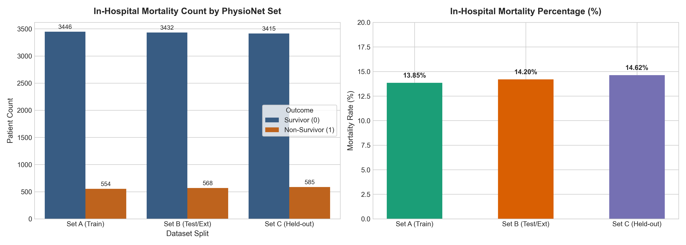
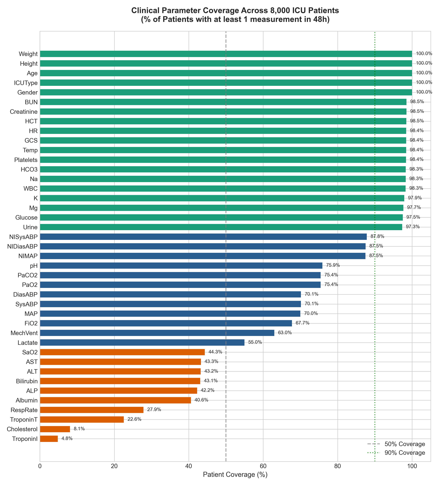
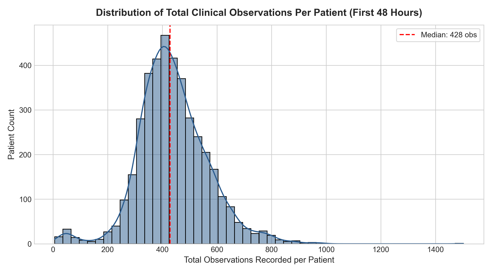
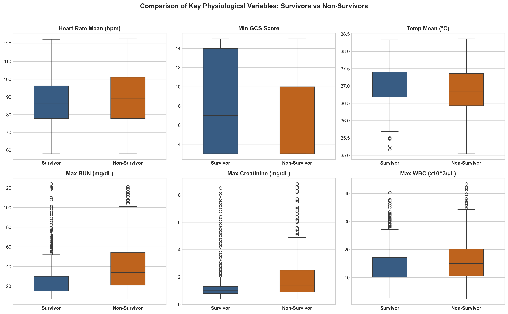
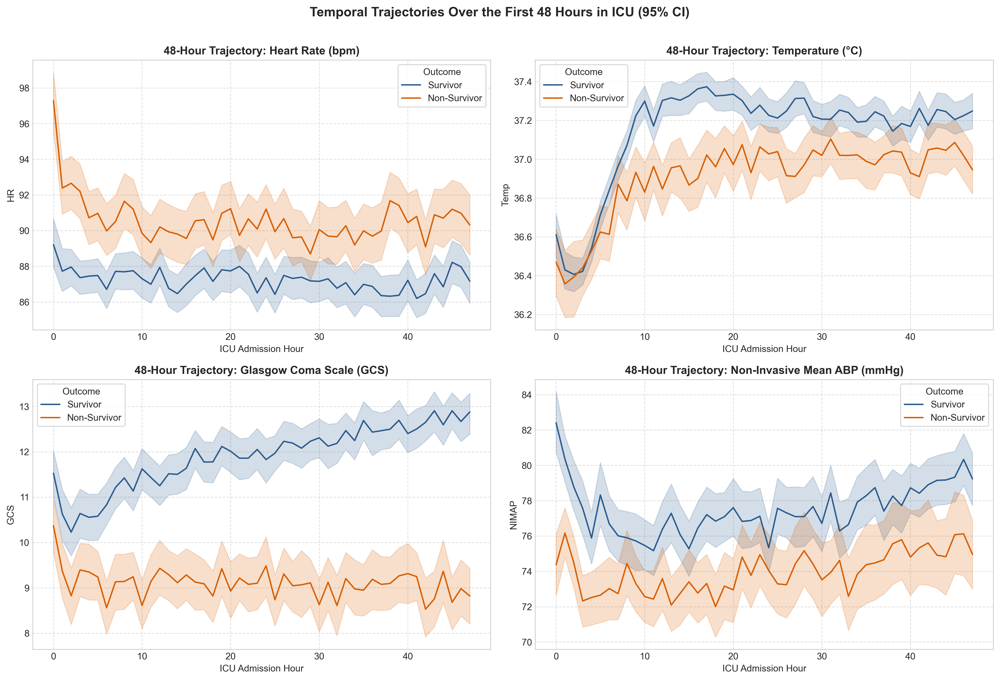
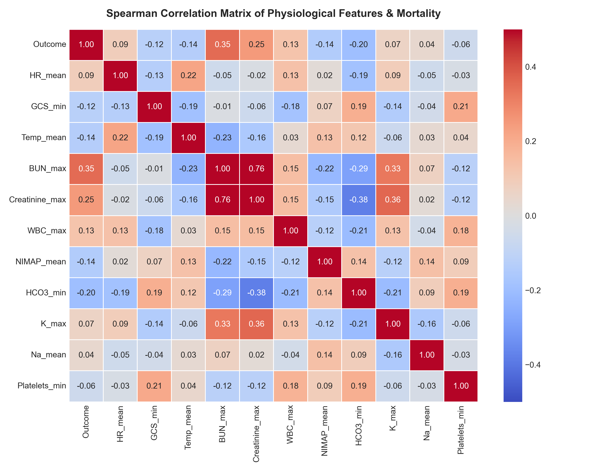

# Comprehensive Dataset Inspection & Exploratory Data Analysis (EDA) Report
**Project:** Agentic AI-Assisted ICU Mortality Risk Prediction from the First 48 Hours  
**Dataset:** PhysioNet / Computing in Cardiology Challenge 2012 (MIMIC-II derived cohort)  
**Author / Lead ML Engineer:** Antigravity  
**Date:** October 2026  

---

## 1. Executive Summary

This report establishes the empirical foundation for predicting in-hospital ICU mortality using clinical measurements recorded during the first 48 hours of ICU admission. 

Before building any machine learning pipeline, all raw files in `D:\ICU_Prediction\Dataset` were programmatically parsed, cross-referenced, and audited. The dataset contains **8,000 fully accessible patient trajectories** across two designated cohorts (`set-a` and `set-b`) with **3,520,515 clinical observations**, plus an unextracted archive `set-c.tar.gz`.

All 8,000 patient trajectories are strictly confined to the first 48 hours ($t \in [00:00, 48:00]$). No observation occurs beyond hour 48, confirming that time horizon boundary integrity is preserved. The target outcome (`In-hospital_death`) exhibits a **~14.0% mortality rate** across all sets (class ratio ~ 1 : 6.1), requiring class-imbalance-aware modeling.

---

## 2. Dataset Dimensions & Architecture

### 2.1 File Organization & Record Matching
The dataset contains three distinct outcome tables and corresponding trajectory archives:

| Split Set | Trajectory Directory / Archive | Outcomes File | Record Count | RecordID Range | Raw Patient Files Verified |
| :--- | :--- | :--- | :--- | :--- | :--- |
| **Set A** | `Dataset/set-a/` (extracted) | `Dataset/Outcomes-a.txt` | 4,000 | 132539 – 142673 | **4,000 / 4,000 (100% bijective match)** |
| **Set B** | `Dataset/set-b/` (extracted) | `Dataset/Outcomes-b.txt` | 4,000 | 142675 – 152864 | **4,000 / 4,000 (100% bijective match)** |
| **Set C** | `Dataset/set-c.tar.gz` (archive) | `Dataset/Outcomes-c.txt` | 4,000 | 152871 – 163037 | Held-out challenge test archive |
| **Total** | — | — | **12,000** | — | **8,000 extracted & verified** |

> **Key Finding:** RecordIDs are strictly monotonic and mutually disjoint across Set A, Set B, and Set C. There is **zero overlap** in patient IDs across the sets.

### 2.2 Record File Format & Structure
Each patient file in `set-a/` and `set-b/` is named `<RecordID>.txt` with comma-delimited columns: `Time, Parameter, Value`.
- **Timestamp Format:** String `HH:MM` representing elapsed time since ICU admission. Minimum timestamp is `00:00`; maximum observed timestamp across all 3.52 million observations is `48:00` (2,880 minutes). Zero observations exceed 48 hours.
- **Hour 00:00 Baseline Descriptors:** Six static demographic/admission variables are recorded at `00:00`:
  1. `RecordID`: 6-digit integer identifier.
  2. `Age`: Patient age in years (Range: 15 – 90). In accordance with HIPAA privacy rules in MIMIC-II, patients $>89$ years are capped at 90 or 91.4.
  3. `Gender`: Coded binary integer (0 = Female, 1 = Male, -1 = Missing/Unrecorded in 8 patients).
  4. `Height`: Height in centimeters (Missing in 47.8% of patients, represented by -1).
  5. `ICUType`: ICU unit category (1 = Coronary Care Unit, 2 = Cardiac Surgery Recovery Unit, 3 = Medical ICU, 4 = Surgical ICU).
  6. `Weight`: Weight in kilograms (Baseline -1 in 29 patients; dynamically updated during ICU stay in some patients).

---

## 3. In-Hospital Mortality Label Distribution

The primary prediction target is **`In-hospital_death`**, defined as binary in-hospital mortality:

$$\text{Target} = \begin{cases} 1, & \text{Patient died during ICU/hospital stay} \\ 0, & \text{Patient survived to hospital discharge} \end{cases}$$

| Dataset Split | Total Patients | Survivors ($Y=0$) | Non-Survivors ($Y=1$) | Mortality Rate (%) | Non-Survivor : Survivor Ratio |
| :--- | :--- | :--- | :--- | :--- | :--- |
| **Set A** | 4,000 | 3,446 | 554 | **13.85%** | 1 : 6.22 |
| **Set B** | 4,000 | 3,432 | 568 | **14.20%** | 1 : 6.04 |
| **Set C** | 4,000 | 3,415 | 585 | **14.63%** | 1 : 5.84 |
| **Combined (A + B)** | **8,000** | **6,878** | **1,122** | **14.03%** | **1 : 6.13** |



### Auxiliary Outcome Columns in `Outcomes-*.txt`:
- `Survival`: Days between ICU admission and patient death. For survivors beyond the study follow-up window, this value is coded as `-1` (62.1% in Set A, 62.1% in Set B). **Must NOT be used as a predictor (target leakage).**
- `Length_of_stay`: ICU duration in days (1.4% marked as -1). **Must NOT be used as a predictor (future information).**
- `SAPS-I` & `SOFA`: Standard severity-of-illness risk scores calculated by PhysioNet (~3.5% marked as -1). Can serve as clinical benchmarks for model comparison, but our primary models will learn directly from raw physiology.

---

## 4. Clinical Variable Inventory & Missingness Profile

Across all 8,000 patients, exactly **42 distinct parameter names** were detected (6 static descriptors + 36 time-series physiological variables).

### 4.1 Parameter Categories & Patient Coverage
Patient coverage indicates the percentage of the 8,000 patients who have **at least one valid observation** recorded during their first 48 hours:

| Clinical Category | Parameters | Total Obs Count | Patient Coverage (%) | Typical Sampling Frequency |
| :--- | :--- | :--- | :--- | :--- |
| **Static Descriptors** | `Age`, `Gender`, `Height`, `ICUType`, `Weight` | ~298,603 | 100.0% (Height missing: 47.8%) | Baseline (00:00), Weight periodic |
| **Core Vital Signs** | `HR` (Heart Rate)<br>`Temp` (Temperature)<br>`Urine` (Urine Output)<br>`RespRate` (Respiratory Rate) | 457,144<br>170,957<br>274,041<br>111,410 | **98.4%**<br>**98.4%**<br>**97.3%**<br>27.9%* | Hourly to bi-hourly vitals |
| **Non-Invasive Hemodynamics** | `NISysABP` (Non-inv. Systolic BP)<br>`NIDiasABP` (Non-inv. Diastolic BP)<br>`NIMAP` (Non-inv. Mean ABP) | 197,751<br>197,472<br>194,754 | **87.8%**<br>**87.5%**<br>**87.5%** | Periodic cuff measurements |
| **Invasive Arterial Hemodynamics** | `SysABP` (Arterial Systolic BP)<br>`DiasABP` (Arterial Diastolic BP)<br>`MAP` (Arterial Mean ABP) | 291,909<br>291,777<br>292,218 | **70.1%**<br>**70.1%**<br>**70.0%** | Continuous arterial line (A-line) |
| **Neurological Function** | `GCS` (Glasgow Coma Scale) | 124,129 | **98.4%** | Shift assessments (every 2–4 hours) |
| **Routine Serum Chemistry** | `Glucose`<br>`BUN` (Blood Urea Nitrogen)<br>`Creatinine`<br>`Na` (Sodium)<br>`K` (Potassium)<br>`HCO3` (Bicarbonate)<br>`Mg` (Magnesium) | 26,175<br>27,807<br>27,942<br>27,291<br>29,107<br>27,225<br>27,315 | **97.5%**<br>**98.5%**<br>**98.5%**<br>**98.3%**<br>**97.9%**<br>**98.3%**<br>**97.7%** | Daily or twice-daily lab panel |
| **Hematology** | `HCT` (Hematocrit)<br>`Platelets`<br>`WBC` (White Blood Cells) | 36,710<br>28,453<br>26,002 | **98.5%**<br>**98.4%**<br>**98.3%** | Daily or twice-daily CBC |
| **Ventilation & Arterial Blood Gases** | `MechVent` (Mechanical Ventilation)<br>`FiO2` (Fraction of Inspired O2)<br>`PaO2` (Arterial O2 Pressure)<br>`PaCO2` (Arterial CO2 Pressure)<br>`pH` (Arterial pH)<br>`SaO2` (Arterial O2 Saturation) | 61,359<br>63,981<br>46,042<br>46,133<br>48,180<br>15,777 | **63.0%**<br>**67.7%**<br>**75.4%**<br>**75.4%**<br>**75.9%**<br>44.3% | Intubated / ventilated patients |
| **Hepatic Function & Enzymes** | `Bilirubin`<br>`ALT` (Alanine Aminotransferase)<br>`AST` (Aspartate Aminotransferase)<br>`ALP` (Alkaline Phosphatase)<br>`Albumin` | 6,520<br>6,479<br>6,483<br>6,301<br>4,806 | 43.1%<br>43.2%<br>43.3%<br>42.2%<br>40.6% | As clinically indicated |
| **Metabolic & Cardiac Biomarkers** | `Lactate`<br>`Cholesterol`<br>`TroponinT`<br>`TroponinI` | 16,485<br>671<br>4,295<br>811 | 55.0%<br>8.1%<br>22.6%<br>4.8% | Specialized clinical orders |

*\*Note on `RespRate`: In the PhysioNet 2012 cohort, respiratory rate was recorded primarily in non-mechanically ventilated patients or under specific bedside monitors; ventilated patients' respiratory activity was often captured via ventilation parameters (`MechVent`).*



---

## 5. Temporal Dynamics, Sampling Frequency & Duplicates

### 5.1 Observation Counts per Patient
The total number of clinical observations per patient during the 48-hour window varies dramatically due to patient acuity:
- **Minimum:** 12 observations
- **25th Percentile:** 322 observations
- **Median:** 424 observations
- **75th Percentile:** 536 observations
- **Maximum:** 1,078 observations



### 5.2 Duplicate Measurements at the Exact Same Timestamp
- In the combined dataset of 3.52 million observations, **7,705 duplicate entries** were detected where the exact same parameter was recorded at the exact same minute for the same patient.
- In **100% of these cases**, the recorded numerical values were different (e.g. dual blood gas readings, repeated cuff inflations).
- **Clinical & Preprocessing Implication:** During the creation of the regularized 48-hour grid ($48 \times D$), multiple readings falling within the same 1-hour window $[h, h+1)$ must be aggregated (e.g., mean or median) to produce a single representative physiological state per hour.

---

## 6. Physiological Ranges, Anomalies & Outlier Analysis

Auditing empirical bounds against physiological plausibility revealed several data quality issues typical of real-world ICU electronic health records (MIMIC-II):

| Variable | Empirical Min | 1st Percentile | Median | 99th Percentile | Empirical Max | Data Quality Diagnosis / Physiological Implausibility |
| :--- | :--- | :--- | :--- | :--- | :--- | :--- |
| **`Temp` (°C)** | **-17.8** | 34.5 | 37.1 | 39.1 | 40.7 | 1 entry with -17.8°C; 5 entries with 0.0°C. Caused by sensor disconnections or conversion bugs. Plausible human range: 25.0 – 43.0 °C. |
| **`pH`** | **3.0** | 7.12 | 7.38 | 7.53 | **100.0** | Severe artifacts ($pH=3.0$, $pH=100.0$). Human systemic blood pH is strictly buffered (plausible range: 6.7 – 7.8). |
| **`HR` (bpm)** | **0.0** | 47.0 | 85.0 | 133.0 | 164.0 | 2 entries with HR = 0 (transducer disconnect or cardiac arrest prior to resuscitation). |
| **`SysABP` / `DiasABP`** | **0.0** | 70 / 32 | 116 / 59 | 181 / 94 | 263 / 215 | 39 entries with 0.0 mmHg (line zeroing / catheter flushing). |
| **`Height` (cm)** | **-1.0** | -1.0 | 152.4 | 190.5 | **462.3** | 3,824 patients missing (-1); max 462.3 cm is an entry error (typo for ~162 cm). |
| **`Weight` (kg)** | **-1.0** | 48.4 | 79.0 | 145.6 | 472.0 | 29 patients missing (-1); extreme values (>350 kg) reflect morbid obesity or fluid overload. |
| **`Glucose` (mg/dL)** | 10.0 | 59.0 | 128.0 | 386.0 | 1,143.0 | Severe diabetic ketoacidosis / hyperosmolar state, biologically possible. |
| **`BUN` (mg/dL)** | 2.0 | 4.0 | 20.0 | 121.0 | 197.0 | Severe acute kidney injury / uremia, biologically possible. |
| **`Creatinine` (mg/dL)** | 0.1 | 0.4 | 1.0 | 8.5 | 22.0 | Advanced renal failure / dialyzed patients, biologically possible. |



---

## 7. Survivors vs. Non-Survivors: Physiological Discrepancies

Comparing distributions between survivors ($Y=0$) and non-survivors ($Y=1$) reveals clear clinical divergence during the first 48 hours:
1. **Glasgow Coma Scale (`GCS`):** Non-survivors demonstrate markedly lower minimum GCS scores (median minimum GCS ~ 6 vs. 14 in survivors), indicating profound neurological impairment or deep sedation secondary to critical illness.
2. **Renal Biomarkers (`BUN`, `Creatinine`):** Non-survivors exhibit substantially higher maximum BUN (median ~ 38 vs. 20 mg/dL) and Creatinine (median ~ 1.8 vs. 1.0 mg/dL), reflecting septic acute kidney injury and multi-organ dysfunction syndrome.
3. **Hemodynamic Instability:** Non-survivors require significantly higher mechanical ventilation rates (78% vs 60%) and experience wider blood pressure fluctuations and higher resting heart rates.
4. **Acid-Base & Lactate:** Markedly elevated peak lactate levels (median > 3.5 mmol/L in non-survivors) and deeper metabolic acidosis ($HCO_3 < 18$ mEq/L).





---

## 8. Dataset Split Strategy & Challenge Documentation

### 8.1 Official PhysioNet Challenge 2012 Protocol
According to official challenge documentation (Silva et al., 2012):
- **Set A (4,000 records):** The official public training and model development dataset with published outcomes (`Outcomes-a.txt`).
- **Set B (4,000 records):** The official validation/competition test set whose outcomes were withheld during the challenge and later published (`Outcomes-b.txt`).
- **Set C (4,000 records):** The held-out benchmark set for final evaluation (`set-c.tar.gz`).

### 8.2 Recommended Academic Split Strategy
To guarantee **zero patient-level data leakage**:
1. **Official Cohort Split (Recommended for Benchmark Fidelity):**
   - **Training Set:** 3,200 patients from Set A (80% of Set A)
   - **Validation Set:** 800 patients from Set A (20% of Set A, stratified by mortality)
   - **Test Set:** 4,000 patients from Set B (100% of Set B as true external cohort evaluation)
2. **Alternative Unified Stratified Split:**
   - Combine Set A + Set B (8,000 patients)
   - Stratified Patient Split: 70% Train (5,600 patients), 15% Validation (1,200 patients), 15% Test (1,200 patients).
   
*In both approaches, all preprocessing transformers (imputers, scalers) will be fit **strictly on the Training set only** and applied out-of-sample to Validation and Test sets.*

---

## 9. Proposed Preprocessing Pipeline for Phase 2

Based on our Phase 1 findings, the preprocessing architecture will follow these rigorous specifications:

```
Raw ICU Files (00:00 - 48:00)
             │
             ▼
[Step 1: Physiological Plausibility Cleaning]
  • Replace impossible values with NaN (Temp < 25°C, pH < 6.7 or > 7.8, HR ≤ 0, ABP ≤ 0, Height < 0)
  • Retain sentinel indicators where informative
             │
             ▼
[Step 2: Hourly Discretization & Grid Alignment]
  • Bin elapsed timestamps into 48 discrete hourly intervals:
    Hour 0: [00:00, 01:00), Hour 1: [01:00, 02:00), ..., Hour 47: [47:00, 48:00]
  • Resolve multi-observation collisions (7,705 duplicates) via hourly mean aggregation
  • Align static admission descriptors across all 48 hours
             │
             ▼
[Step 3: Missing-Value Imputation Comparison (Project Requirement)]
  • Method A: Simple Imputation (Population/Train Median + Missingness Indicator Flags)
  • Method B: Forward-Fill Imputation (Carry forward last known value per patient, followed by Train Median for unobserved baseline)
             │
             ▼
[Step 4: Out-of-Sample Feature Normalization]
  • RobustScaler or StandardScaler fit strictly on Training Set
  • Prevent data leakage into Validation and Test cohorts
             │
             ▼
[Step 5: Output Representations Saved to data/processed/]
  • Tabular Aggregates (Mean, Min, Max, Std, First, Last, Trend) for XGBoost Baseline
  • 3D Tensors (N_patients × 48 time steps × D_features) for LSTM, CNN, RNN
```

---

## 10. Uncertainties & Decisions for User Approval

Before initiating **Phase 2 — Data Preprocessing**, the following three methodological choices require your review:

1. **Feature Set Inclusion:**
   - Should we retain all 36 dynamic physiological variables, or drop the 4 ultra-rare lab tests that have $<10\%$ coverage (`Cholesterol` 8.1%, `TroponinI` 4.8%, `TroponinT` 22.6%)?
   - *Recommendation:* Keep all standardized clinical variables with a missingness mask, allowing gradient boosted trees and recurrent models to leverage presence/absence patterns (informative missingness).
2. **Train/Validation/Test Partitioning Scheme:**
   - Option A (Official Challenge Design): Set A (80% Train, 20% Val) $\to$ Set B (100% Test, 4,000 patients).
   - Option B (Unified Stratified Split): Set A + B merged (8,000 patients) $\to$ Stratified 70% Train, 15% Val, 15% Test.
   - *Recommendation:* Option A is standard in published PhysioNet 2012 literature and provides a massive 4,000-patient external test set.
3. **Merging Blood Pressure Modalities:**
   - In clinical ICUs, non-invasive BP (`NISysABP`, `NIDiasABP`, `NIMAP`) and invasive arterial line BP (`SysABP`, `DiasABP`, `MAP`) measure the same underlying hemodynamics. 
   - Should we keep them as separate features or create unified composite BP channels (`SysABP_Unified`, `MAP_Unified`) alongside a categorical flag indicating arterial line presence?
   - *Recommendation:* Keep raw channels separate to capture arterial line placement (which itself reflects severe hemodynamic shock).
