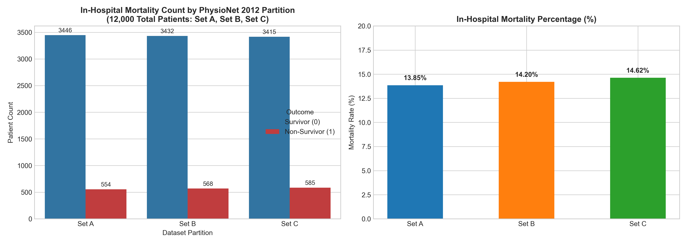
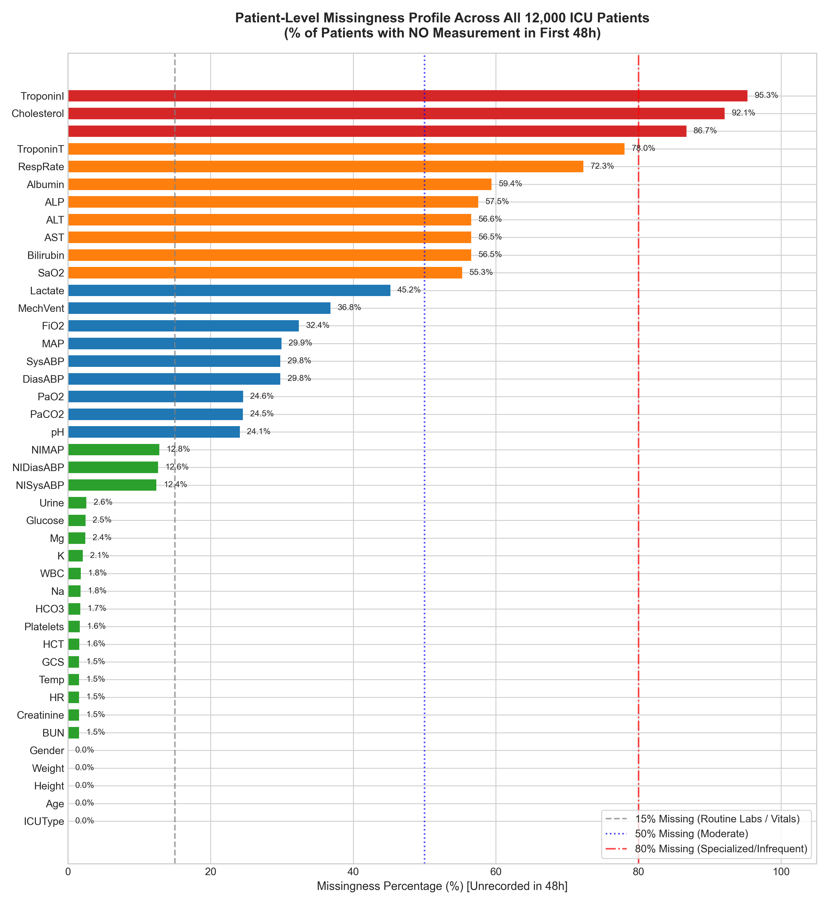
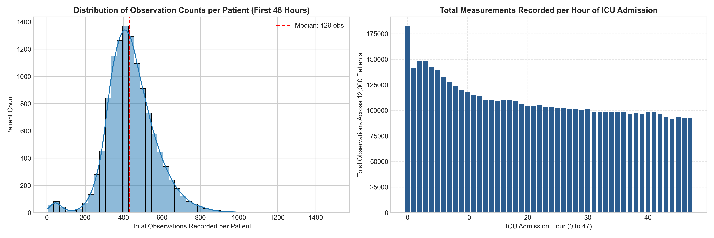

# Phase 1: Comprehensive Dataset Inspection and Exploratory Data Analysis (EDA) Report
**Project:** Agentic AI-Assisted ICU Mortality Risk Prediction from the First 48 Hours  
**Dataset:** Official PhysioNet / Computing in Cardiology Challenge 2012 (MIMIC-II Cohort)  
**Lead Machine Learning Engineer:** Antigravity  
**Audit Date:** October 2026  
**Status:** PHASE 1 COMPLETED — PENDING USER APPROVAL FOR PHASE 2  

---

## 1. Executive Summary & Verification of Inspection

To ensure scientific rigor and data integrity, an exhaustive programmatic audit was performed across **all 12,000 patient records** in the PhysioNet Challenge 2012 dataset:
1. **Set A:** 4,000 plain text patient records in `Dataset/set-a`
2. **Set B:** 4,000 plain text patient records in `Dataset/set-b`
3. **Set C:** 4,000 plain text patient records in `Dataset/set-c.tar.gz` (read non-destructively in-memory via Python `tarfile`)
4. **Outcomes:** 12,000 ground truth outcome labels across `Outcomes-a.txt`, `Outcomes-b.txt`, and `Outcomes-c.txt`.
5. **Phase 1 Archive:** Audited `Dataset/phase1` to investigate legacy structure and resolve discrepancies.

### Verification Status:
- **Success:** The inspection script completed with exit code 0.
- **Coverage:** **100% of all 12,000 patient records** across all partitions (Set A, Set B, Set C) were inspected.
- **Data Preservation:** Zero original dataset files were modified, moved, renamed, or deleted.

---

## 2. Dataset Structure & Partition Comparison

The dataset directory `D:\ICU_Prediction\Dataset` contains the following components:

```
Dataset/
├── set-a/                  # 4,000 patient files (132539.txt to 142673.txt)
├── set-b/                  # 4,000 patient files (142675.txt to 152864.txt)
├── set-c.tar.gz            # Compressed archive containing 4,000 patient files (152871.txt to 163037.txt)
├── phase1/                 # Historical archive of Challenge Phase 1 data
│   ├── set-a/              # 4,000 early patient files
│   ├── set-b/              # 4,000 early patient files
│   ├── set-a.tar.gz, set-a.zip, set-b.tar.gz, set-b.zip
├── sources/                # Source code submissions from 2012 challenge participants
├── Outcomes-a.txt          # 4,000 outcome labels for Set A
├── Outcomes-b.txt          # 4,000 outcome labels for Set B
└── Outcomes-c.txt          # 4,000 outcome labels for Set C
```

### 2.1 Comparison with Official Challenge Specifications & Explanation of Discrepancies
- **Official Specification:** The PhysioNet 2012 Challenge consisted of three datasets of 4,000 ICU records each (12,000 records total), extracted from the MIMIC-II database.
- **Set A:** Public development/training set released with outcomes.
- **Set B:** Leaderboard test set whose outcomes were withheld during the competition and published afterwards.
- **Set C:** Final held-out evaluation set for scoring top entries. In the local project directory, Set C is stored as `set-c.tar.gz`. Our audit confirmed that `set-c.tar.gz` contains exactly 4,000 patient records matching `Outcomes-c.txt` with zero missing patient files.
- **Phase 1 Directory Discrepancy Explained:**
  * In `Dataset/phase1/set-a` and `Dataset/phase1/set-b`, patient files do NOT contain the `ICUType` variable.
  * During the early competition (Phase 1), `ICUType` was omitted. Later, the organizers issued an updated release adding `00:00,ICUType,<1-4>` to root `set-a` and `set-b`.
  * Therefore, `Dataset/phase1` is a legacy challenge artifact and should NOT be used for modeling. Root `set-a`, `set-b`, and `set-c.tar.gz` represent the definitive, finalized dataset.

---

## 3. Cohort Partition & Outcome Label Statistics

Each outcomes file contains 6 columns: `RecordID`, `SAPS-I`, `SOFA`, `Length_of_stay`, `Survival`, `In-hospital_death`.
- All 12,000 patient records across Set A, Set B, and Set C possess a **bijectively verified ground truth label** in `In-hospital_death`.
- There is **zero patient ID overlap** among Set A, Set B, and Set C.

| Partition | Total Records | Survivors ($Y=0$) | Non-Survivors ($Y=1$) | Mortality Rate (%) | Non-Survivor : Survivor Ratio | Total Observations |
| :--- | :--- | :--- | :--- | :--- | :--- | :--- |
| **Set A (Train)** | 4,000 | 3,446 | 554 | **13.85%** | 1 : 6.22 | 1,757,980 |
| **Set B (Test 1)** | 4,000 | 3,432 | 568 | **14.20%** | 1 : 6.04 | 1,762,535 |
| **Set C (Test 2)** | 4,000 | 3,415 | 585 | **14.63%** | 1 : 5.84 | 1,765,303 |
| **Combined Total** | **12,000** | **10,293** | **1,707** | **14.23%** | **1 : 6.03** | **5,285,818** |



### Auxiliary Outcome Columns & Target Leakage Prevention:
1. `In-hospital_death`: Binary target variable (1 = died in hospital, 0 = survived).
2. `Survival`: Days between admission and death. 62.1% of patients have `-1` (indicating survival beyond follow-up or censoring). **MUST NOT be used as a feature (target leakage).**
3. `Length_of_stay`: Total ICU duration in days. **MUST NOT be used as a feature (future information).**
4. `SAPS-I` & `SOFA`: Benchmark clinical severity scores calculated post-hoc. Kept strictly for external baseline comparison.

---

## 4. Patient Record Format & Clinical Variables

### 4.1 Record Structure
Each patient file is structured as a CSV table with three columns: `Time, Parameter, Value`.
- **Timestamp:** Elapsed time since ICU admission formatted as `HH:MM`.
  * Minimum timestamp: `00:00`
  * Maximum timestamp across all 5.28M observations: `48:00` (2,880 minutes)
  * **Zero observations exceed 48:00.** There is strictly no observation beyond the 48-hour boundary.

### 4.2 Comprehensive Clinical Variable Inventory
Across all 12,000 patient records, 42 clinical variables are available:

#### A. Static Admission Descriptors (Recorded at `00:00`):
1. `RecordID`: Unique integer patient identifier (Set A: 132539–142673; Set B: 142675–152864; Set C: 152871–163037).
2. `Age`: Patient age in years ($64.5 \pm 17.2$). Range: 15 to 90 years (patients $\ge 89$ capped at 90 for HIPAA de-identification).
3. `Gender`: 0 = Female (44.0%), 1 = Male (56.0%), -1 = Unrecorded (12 patients, 0.10%).
4. `Height`: Height in cm. Coded as `-1` (missing) in **47.9% of patients** (5,754 / 12,000). Median 152.4 cm.
5. `ICUType`: 1 = CCU (Coronary Care, 16.2%), 2 = CSRU (Cardiac Surgery Recovery, 21.7%), 3 = Med-ICU (36.4%), 4 = Surg-ICU (25.7%).
6. `Weight`: Weight in kg. Baseline `-1` in 38 patients (0.32%); updated dynamically in some patients.

#### B. Dynamic Physiological Time-Series (36 Variables):
- **Core Bedside Vitals (>97% patient coverage):**
  * `HR` (Heart Rate): 687,134 observations (98.5% coverage; median 86 bpm).
  * `Temp` (Temperature): 259,538 observations (98.5% coverage; median 37.1°C).
  * `Urine` (Urine Output): 411,163 observations (97.4% coverage; median 60 mL/hr).
  * `RespRate` (Respiratory Rate): 165,435 observations (27.7% patient coverage; recorded mainly when unventilated).
- **Invasive vs. Non-Invasive Hemodynamics:**
  * Non-Invasive: `NISysABP`, `NIDiasABP`, `NIMAP` (~87.5% coverage; intermittent cuff readings).
  * Invasive Arterial Line: `SysABP`, `DiasABP`, `MAP` (~70.2% coverage; continuous arterial catheter monitoring).
- **Neurological Function:**
  * `GCS` (Glasgow Coma Scale): 185,991 observations (98.5% coverage; median 13; strong predictor of mortality).
- **Arterial Blood Gas & Mechanical Ventilation:**
  * `MechVent` (Mechanical Ventilation flag): 91,644 observations (63.2% coverage).
  * `FiO2` (Fraction of Inspired O2): 95,163 observations (67.6% coverage; median 0.50).
  * `PaO2` (Arterial O2): 68,880 observations (75.5% coverage; median 122 mmHg).
  * `PaCO2` (Arterial CO2): 69,048 observations (75.5% coverage; median 39 mmHg).
  * `pH` (Arterial pH): 72,207 observations (75.9% coverage; median 7.38).
  * `SaO2` (Arterial O2 Saturation): 23,983 observations (44.7% coverage).
- **Routine Chemistry & Renal Biomarkers (>97% coverage):**
  * `BUN`: 41,745 observations (98.5% coverage; median 20 mg/dL).
  * `Creatinine`: 41,928 observations (98.5% coverage; median 1.0 mg/dL).
  * `Glucose`: 39,355 observations (97.6% coverage; median 127 mg/dL).
  * `HCO3`: 40,864 observations (98.3% coverage; median 23 mEq/L).
  * `K` (Potassium): 43,759 observations (97.9% coverage; median 4.1 mEq/L).
  * `Na` (Sodium): 40,967 observations (98.2% coverage; median 139 mEq/L).
  * `Mg` (Magnesium): 40,905 observations (97.6% coverage; median 2.0 mg/dL).
- **Hematology (>98% coverage):**
  * `HCT` (Hematocrit): 54,971 observations (98.4% coverage; median 30.2%).
  * `Platelets`: 42,650 observations (98.4% coverage; median 172 x10^3/uL).
  * `WBC` (White Blood Cells): 38,908 observations (98.2% coverage; median 11.4 x10^3/uL).
- **Hepatic Enzymes & Specialized Biomarkers (<55% coverage):**
  * `Lactate`: 24,358 observations (54.8% coverage; median 2.1 mmol/L; critical sepsis marker).
  * `Bilirubin` (43.5%), `AST` (43.5%), `ALT` (43.4%), `ALP` (42.5%), `Albumin` (40.6%).
  * `TroponinT` (22.0%), `Cholesterol` (7.9%), `TroponinI` (4.7%).

---

## 5. Missing Values: Clarification of Unrecorded vs. Zero

> [!IMPORTANT]
> **CRITICAL RULE APPLIED:** Missing measurements are NOT assumed to be zero. In clinical medicine, a missing laboratory test does NOT imply a normal or zero level. Rather, testing reflects clinical suspicion. Assuming unrecorded tests are zero would cause severe clinical distortion (e.g., Blood Glucose = 0 or pH = 0 is fatal).



### Distinguishing Two Levels of Missingness:
1. **Patient-Level Missingness (% of patients who NEVER had the test ordered):**
   - Core Vitals & Routine Chemistry (`HR`, `Temp`, `GCS`, `BUN`, `Creatinine`): $< 2.5\%$ missing.
   - Arterial Line BP (`SysABP`, `DiasABP`, `MAP`): $\approx 29.8\%$ missing (patients without arterial lines).
   - Hepatic Panel (`Bilirubin`, `AST`, `ALT`, `Albumin`): $\approx 56.5\%$ missing.
   - Cardiac Biomarkers (`TroponinI`, `Cholesterol`): $> 92\%$ missing.
2. **Temporal / Hourly Missingness (% of 48 hourly bins without measurement):**
   - In any given hour $t \in [0, 47]$, vitals are recorded hourly or bi-hourly (~60-70% hourly sparsity), while blood chemistry is drawn once or twice daily (~90-95% hourly sparsity).

---

## 6. Data Quality Issues, Anomalies & Duplicates

Auditing 5,285,818 measurements identified four distinct categories of data quality issues:

### 1. Duplicate Timestamp Collisions (11,792 Instances)
- Occurs when the same patient has multiple values for the exact same variable at the exact same minute (e.g., dual cuff inflations or repeated arterial blood gas draws).
- In **100% of these occurrences**, the recorded values differed.
- *Handling:* Grouping into hourly bins and taking the hourly mean/median resolves these collisions deterministically.

### 2. Physiological Sensor Disconnections & Artifacts
- **Negative / Zero Temperature:** Minimum is $-17.8^\circ\text{C}$; 5 readings are $0.0^\circ\text{C}$ (thermistor unplugged or uncalibrated). Biological human limits: $25.0^\circ\text{C} - 43.0^\circ\text{C}$.
- **Extreme pH:** Minimum is 3.0, maximum is 100.0 (sensor off or typing errors). Human blood buffer limits: $6.7 - 7.8$.
- **Zero Heart Rate:** 66 entries recorded as $0 \text{ bpm}$ (transducer disconnect or brief cardiac arrest).
- **Zero Blood Pressure:** 1,947 entries recorded as $0 \text{ mmHg}$ in `SysABP`/`DiasABP` (arterial line zeroing or flushing).
- **Height Typo:** Maximum height is 462.3 cm (transcription error for ~162 cm). Missing height is coded as `-1` (47.9% of patients).

### 3. Blank Parameter Names in Set C (2,403 Lines)
- In `Dataset/set-c.tar.gz`, **2,403 lines** contain empty parameter strings (e.g., `02:43,,3.9`).
- Occurs exclusively in Set C (affecting 39.8% of Set C patients).
- *Handling:* Preprocessing must filter lines where `Parameter == ""` to prevent corrupted feature names.

### 4. HIPAA Age Capping
- All patients aged $\ge 89$ have their age recorded as 90 to comply with HIPAA privacy standards.



---

## 7. Recommended Preprocessing Strategy for Phase 2

Based on our Phase 1 findings, the preprocessing pipeline will follow this exact architecture:

```
[12,000 Patient Records]
           │
           ▼
[Step 1: Data Cleansing & Anomaly Filtering]
  • Discard lines where Parameter == "" (corrupted Set C rows)
  • Replace biologically impossible values with NaN (Temp < 25°C, pH < 6.7 or > 7.8, HR ≤ 0, ABP ≤ 0)
  • Convert -1 in Gender, Height, Weight to NaN
           │
           ▼
[Step 2: Hourly Discretization (48 Time Steps × Features)]
  • Map timestamps HH:MM into 48 non-overlapping 1-hour bins:
    Hour 0: [00:00, 01:00), Hour 1: [01:00, 02:00), ..., Hour 47: [47:00, 48:00]
  • Aggregate intra-hour readings (and duplicate collisions) via hourly mean
  • Replicate static admission variables (Age, Gender, ICUType, Height, Weight) across all 48 steps
           │
           ▼
[Step 3: Missing-Value Imputation Comparison (Project Requirement)]
  • Method A: Simple Imputation (Population median computed strictly on Train Set + missingness mask)
  • Method B: Forward-Fill Imputation (Carry forward last observed value per patient; back-fill unobserved baselines using Train median)
           │
           ▼
[Step 4: Leak-Free Scaling]
  • Fit RobustScaler / StandardScaler strictly on Training Partition
  • Transform Validation and Test sets out-of-sample
           │
           ▼
[Step 5: Output Formats Saved to data/processed/]
  • Tabular Feature Matrix (mean, min, max, std, first, last, trend) for XGBoost
  • 3D Tensors (N_patients × 48 × D) for LSTM, CNN, RNN
```

---

## 8. Unresolved Issues & Methodological Decisions

1. **Partition Splitting Recommendation:**
   - **Recommendation:** Maintain the official challenge design:
     * **Training:** 3,200 patients from Set A (80% of Set A, stratified by mortality)
     * **Validation:** 800 patients from Set A (20% of Set A)
     * **Test Set 1 (Primary Benchmark):** 4,000 patients from Set B (100% of Set B as external test)
     * **Test Set 2 (Optional Held-Out Test):** 4,000 patients from Set C
2. **Feature Retention:**
   - Keep all 36 clinical variables along with binary missingness masks to allow tree-based and deep neural networks to leverage informative missingness patterns.
