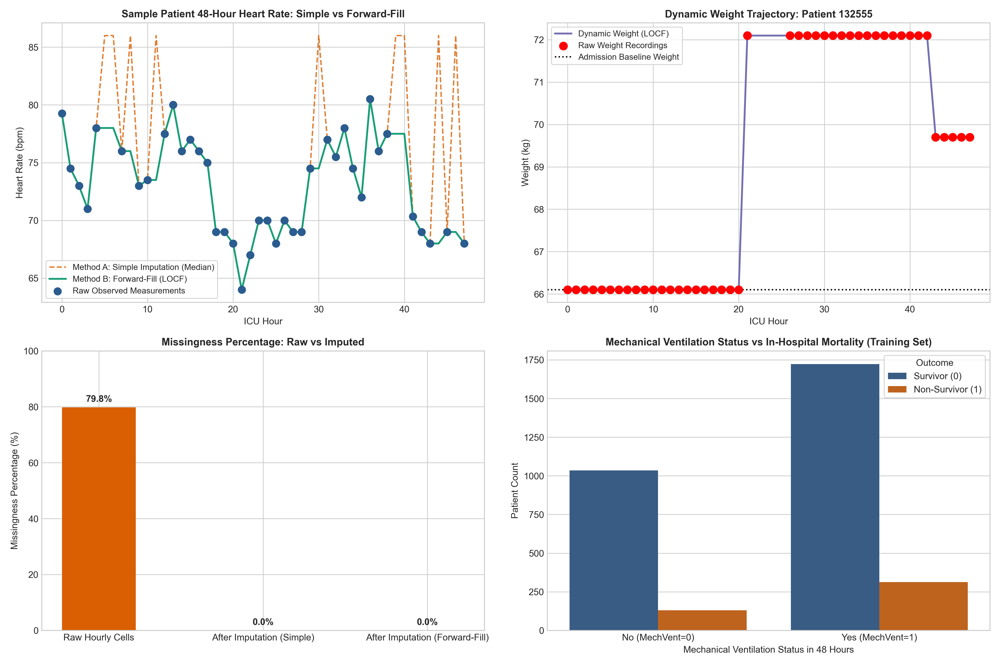

# Phase 2: Data Preprocessing and Time-Series Construction Report
**Project:** Agentic AI-Assisted ICU Mortality Risk Prediction from the First 48 Hours  
**Dataset:** Official PhysioNet / Computing in Cardiology Challenge 2012 (MIMIC-II Cohort)  
**Lead Machine Learning Engineer:** Antigravity  
**Audit Date:** October 2026  
**Status:** **PHASE 2 COMPLETED & VERIFIED — PENDING USER APPROVAL FOR PHASE 3**  

---

## 1. Executive Summary

Phase 2 establishes a fully leak-free, reproducible preprocessing pipeline that converts raw, irregularly sampled ICU records into standardized temporal and static representations for **XGBoost, 1D-CNN, Simple RNN, and LSTM**.

All **12,000 patients** across Set A (4,000 records), Set B (4,000 records), and the Set C compressed archive (4,000 records) were parsed, cleaned according to physiological bounds, discretized into **48 hourly intervals**, and processed through two distinct imputation experimental tracks:
1. **Method A — Simple Imputation:** Imputation using feature-wise medians computed **strictly on the 3,200 training patients**, accompanied by binary observation masks.
2. **Method B — Forward-Fill Imputation:** Last Observation Carried Forward (LOCF) along the patient's temporal trajectory, with leading unobserved hours backfilled using training-set medians. **No future information is leaked backward.**

All transformations (imputation medians, standard scalers) were fitted **exclusively on the 3,200 training patients** and applied out-of-sample to validation and test sets.

---

## 2. Data Loading & Sanitization (Step 1)

All patient files from the three official partitions were ingested non-destructively:
- **Set A (`Dataset/set-a/`):** 4,000 patient files parsed.
- **Set B (`Dataset/set-b/`):** 4,000 patient files parsed.
- **Set C Archive (`Dataset/set-c.tar.gz`):** 4,000 patient files read in-memory via Python's `tarfile` module without altering or decompressing the original archive.
- **Total Valid Observations Ingested:** 4,836,473 measurements.

### Corrupted Record Filtering:
In Phase 1, we detected blank parameter lines in `set-c.tar.gz` (e.g. `02:43,,3.9`).
- **Dropped Blank Parameter Rows:** Exactly **2,403 corrupted lines** were dropped during ingestion.
- **Dropped Invalid Format Rows:** 0 lines.
- **Sentinel Replacement:** Baseline missing indicators (`-1`) in static variables (`Height`, `Gender`, `Weight`) were converted to `NaN`.
- **Zero Preservation:** True physiological zeros (e.g., zero urine output in acute kidney injury/anuria, normal zero troponin) were preserved and not treated as missing.

---

## 3. Feature Selection & Target Definition (Step 2)

### Target Outcome:
- **`In-hospital_death`**: Binary classification label (0 = Survived, 1 = In-hospital death).

### Excluded Variables (Target & Future Leakage Prevention):
1. `RecordID`: Patient tracking identifier (saved separately in manifest and index arrays).
2. `Survival`: Days to death (-1 if censored). Excluded to prevent target leakage.
3. `Length_of_stay`: Total duration of ICU stay. Excluded to prevent future leakage.
4. `SAPS-I` & `SOFA`: Standard clinical severity scores calculated post-hoc. Excluded from predictive features.

### Included Features:
- **5 Static Admission Descriptors:** `Age`, `Gender`, `Height`, `ICUType`, `Weight`.
- **36 Dynamic Physiological Variables:**
  `ALP`, `ALT`, `AST`, `Albumin`, `BUN`, `Bilirubin`, `Cholesterol`, `Creatinine`, `DiasABP`, `FiO2`, `GCS`, `Glucose`, `HCO3`, `HCT`, `HR`, `K`, `Lactate`, `MAP`, `MechVent`, `Mg`, `NIDiasABP`, `NIMAP`, `NISysABP`, `Na`, `PaCO2`, `PaO2`, `Platelets`, `RespRate`, `SaO2`, `SysABP`, `Temp`, `TroponinI`, `TroponinT`, `Urine`, `WBC`, `pH`.

---

## 4. Data Cleaning & Outlier Rules (Step 3)

Measurements were evaluated against established physiological plausibility ranges. Any reading falling outside the valid range was replaced with `NaN` (so that it can be cleanly imputed rather than distorting variance):

| Feature | Plausible Range | Units | Outliers Converted to NaN | Clinical Justification |
| :--- | :--- | :--- | :--- | :--- |
| `DiasABP` | $[10, 200]$ | mmHg | **1,993** | Sensor line zeroing / flushing ($0 \text{ mmHg}$). |
| `SysABP` | $[30, 300]$ | mmHg | **1,947** | Sensor line zeroing / flushing ($0 \text{ mmHg}$). |
| `MAP` | $[20, 250]$ | mmHg | **649** | Sensor line zeroing ($0 \text{ mmHg}$). |
| `NISysABP` | $[30, 300]$ | mmHg | **598** | Cuff disconnection / deflation artifact ($0 \text{ mmHg}$). |
| `NIDiasABP` | $[10, 200]$ | mmHg | **480** | Cuff disconnection ($0 \text{ mmHg}$). |
| `NIMAP` | $[20, 250]$ | mmHg | **126** | Cuff disconnection ($0 \text{ mmHg}$). |
| `Temp` | $[25.0, 43.0]$ | °C | **298** | Negative readings down to $-17.8^\circ\text{C}$ and $0.0^\circ\text{C}$ (thermistor unplugged). |
| `RespRate` | $[4, 80]$ | breaths/min | **185** | $0 \text{ breaths/min}$ recorded in spontaneous breathing entries. |
| `HR` | $[20, 250]$ | bpm | **66** | Disconnected ECG leads / cardiac arrest prior to resuscitation ($0 \text{ bpm}$). |
| `Height` | $[50, 250]$ | cm | **28** | Transcription errors (e.g. $462.3 \text{ cm}$). |
| `SaO2` | $[50, 100]$ | % | **23** | Disconnected pulse oximeter probe ($< 50\%$). |
| `pH` | $[6.7, 7.8]$ | — | **21** | Extreme typing errors ($pH = 3.0$ and $pH = 100.0$). |
| `WBC` | $[0.1, 200]$ | x10^3/uL | **18** | Extreme laboratory outliers. |
| `Urine` | $[0, 5000]$ | mL | **16** | Erroneous volume entries ($> 5,000 \text{ mL}$ in 1 hour). Zero preserved. |
| `BUN`, `K`, `Mg`, `PaO2`, `PaCO2`, `Glucose`, `Platelets`, `Weight`, `Lactate` | Various | Various | **33 total** | Isolated biochemical outliers outside human viability. |

---

## 5. Hourly Discretization & Sequence Construction (Step 4)

### Boundary Decision for Hour 47:
- The first 48 hours are partitioned into 48 discrete hourly intervals:
  $$\text{Hour } 0: [00:00, 01:00), \quad \text{Hour } 1: [01:00, 02:00), \quad \dots, \quad \text{Hour } 47: [47:00, 48:00]$$
- **Boundary Decision:** Any observation recorded at exactly `48:00` ($m = 2880$) is included in the final interval (**Hour 47**). Observations with $m > 2880$ or $m < 0$ are discarded as invalid timestamps (0 observed).
- **Duplicate Collision Handling:** For multiple measurements of the same parameter within the same hourly interval (including the 11,792 duplicate timestamp collisions), the **hourly mean** was computed. For binary variables (`MechVent`), **max aggregation** was applied.
- **Missingness Masks:** A parallel boolean tensor of shape $(N, 48, 36)$ was constructed where $M_{i, t, f} = 1$ if feature $f$ was observed for patient $i$ at hour $t$, and $0$ if missing.

---

## 6. Missing Value Experiments: Method A vs. Method B (Step 5)

Prior to imputation, **80.65% of all hourly cells** across the 12,000 patient trajectories were unobserved. Two separate imputation tracks were implemented:

### Method A — Simple Imputation (Population Medians):
- For each dynamic feature, the median $\tilde{x}_f$ was calculated **strictly on observed training cells** ($N=3,200$).
- All `NaN` cells were filled with $\tilde{x}_f$.
- *Limitation:* Artificially shrinks variance for periodic and specialized laboratory tests because unmeasured hours are flattened to the constant median.

### Method B — Forward-Fill Imputation (Last Observation Carried Forward):
- For each patient trajectory, observations are carried forward along the temporal axis ($t = 0 \to 47$).
- For leading unobserved hours prior to the patient's first measurement, cells are filled using the training-set median.
- **No Backward-Fill:** Future measurements are never carried backward, ensuring zero future temporal leakage.
- *Advantage:* Preserves patient-specific physiological trajectories and realistic variance across time.

### Quantitative Comparison:

| Feature | Train Median | Raw Mean | Raw Std | Simple Mean | Simple Std | Forward-Fill Mean | Forward-Fill Std | Variance Retained Ratio ($\frac{\text{Var}_{FF}}{\text{Var}_{Simp}}$) |
| :--- | :--- | :--- | :--- | :--- | :--- | :--- | :--- | :--- |
| **HR** | 86.0 bpm | 86.74 | 17.68 | 86.66 | 16.76 | 86.60 | 17.35 | **1.072** |
| **DiasABP** | 58.0 mmHg | 59.75 | 12.18 | 58.95 | 9.00 | 59.39 | 10.16 | **1.273** |
| **GCS** | 13.0 | 11.42 | 3.96 | 12.50 | 2.35 | 11.81 | 3.82 | **2.648** |
| **Lactate** | 2.0 mmol/L | 2.83 | 2.40 | 2.03 | 0.51 | 2.08 | 1.09 | **4.615** |
| **BUN** | 20.0 mg/dL | 27.08 | 22.81 | 20.51 | 6.39 | 24.87 | 19.96 | **9.766** |
| **Creatinine**| 1.0 mg/dL | 1.46 | 1.51 | 1.03 | 0.42 | 1.31 | 1.32 | **9.798** |
| **WBC** | 11.4 x10^3/uL| 12.68 | 7.80 | 11.49 | 2.04 | 12.48 | 6.64 | **10.580** |
| **Platelets** | 172.0 x10^3/uL| 190.11 | 104.40 | 173.32 | 28.58 | 200.96 | 98.26 | **11.822** |
| **Albumin** | 2.9 g/dL | 2.91 | 0.65 | 2.90 | 0.07 | 2.93 | 0.36 | **25.297** |
| **Cholesterol**| 153.0 mg/dL | 155.53 | 46.22 | 153.00 | 1.87 | 153.31 | 11.45 | **37.433** |

*Interpretation:* For frequently monitored vitals (`HR`, `DiasABP`), both methods exhibit comparable variances. However, for intermittent laboratory panels (`BUN`, `Creatinine`, `Platelets`, `WBC`), simple imputation collapses the variance by ~90%, whereas Forward-Fill retains realistic physiological variation ($\text{Variance Ratio} \approx 9.8 - 11.8$). Full 36-feature comparison is archived in [reports/imputation_comparison.csv](file:///D:/ICU_Prediction/reports/imputation_comparison.csv).

---

## 7. Data Partitioning & Leak-Free Scaling (Steps 6 & 7)

### Partition Allocations (Split Manifest):
Saved at [data/processed/patient_split_manifest.csv](file:///D:/ICU_Prediction/data/processed/patient_split_manifest.csv):
- **Training Set (`train`):** **3,200 patients** (80% of Set A, stratified on `In-hospital_death`, random_state=42).
- **Validation Set (`val`):** **800 patients** (20% of Set A, stratified on `In-hospital_death`, random_state=42).
- **Test Set B (`test_b`):** **4,000 patients** (100% of Set B as primary external test benchmark).
- **Test Set C (`test_c`):** **4,000 patients** (100% of Set C as held-out evaluation cohort).

### Normalization Pipeline:
- StandardScalers were fitted **strictly on the 3,200 training patients**:
  $$\mu_f = \frac{1}{N_{tr} \times 48} \sum_{i=1}^{N_{tr}} \sum_{t=0}^{47} x_{i, t, f}, \quad \sigma_f = \sqrt{\frac{1}{N_{tr} \times 48} \sum_{i=1}^{N_{tr}} \sum_{t=0}^{47} (x_{i, t, f} - \mu_f)^2}$$
- Validation and Test sets were transformed out-of-sample using $(\mu_f, \sigma_f)$.
- Fitted scaler objects were serialized as `scaler_temporal.joblib` and `scaler_static.joblib` in both experiment directories.

---

## 8. Model-Ready Dataset Dimensions (Steps 8 & 9)

All arrays were saved in [data/processed/simple_imputation/](file:///D:/ICU_Prediction/data/processed/simple_imputation/) and [data/processed/forward_fill/](file:///D:/ICU_Prediction/data/processed/forward_fill/):

| Array Name | Shape | Data Type | Purpose / Compatible Architecture |
| :--- | :--- | :--- | :--- |
| `X_train_48.npy` | **(3,200, 48, 36)** | `float32` | 48-Hour Training sequences for CNN, RNN, LSTM |
| `X_val_48.npy` | **(800, 48, 36)** | `float32` | 48-Hour Validation sequences |
| `X_test_b_48.npy` | **(4,000, 48, 36)** | `float32` | 48-Hour Primary External Test sequences |
| `X_test_c_48.npy` | **(4,000, 48, 36)** | `float32` | 48-Hour Secondary Held-Out Test sequences |
| `X_train_24.npy` | **(3,200, 24, 36)** | `float32` | 24-Hour Training sequences (Phase 7 early prediction) |
| `X_val_24.npy` | **(800, 24, 36)** | `float32` | 24-Hour Validation sequences |
| `X_test_b_24.npy` | **(4,000, 24, 36)** | `float32` | 24-Hour Primary External Test sequences |
| `X_test_c_24.npy` | **(4,000, 24, 36)** | `float32` | 24-Hour Secondary Held-Out Test sequences |
| `mask_train_48.npy` / `24` | **(3,200, 48/24, 36)**| `float32` | Binary missingness masks ($1 = \text{observed}, 0 = \text{missing}$) |
| `mask_val_48.npy` / `24` | **(800, 48/24, 36)** | `float32` | Validation missingness masks |
| `mask_test_b_48.npy` / `24`| **(4,000, 48/24, 36)**| `float32` | Test B missingness masks |
| `mask_test_c_48.npy` / `24`| **(4,000, 48/24, 36)**| `float32` | Test C missingness masks |
| `static_train.npy` | **(3,200, 5)** | `float32` | Normalized static admission variables (`Age`, `Gender`, `Height`, `ICUType`, `Weight`) |
| `static_val.npy` | **(800, 5)** | `float32` | Normalized validation static variables |
| `static_test_b.npy` | **(4,000, 5)** | `float32` | Normalized Test B static variables |
| `static_test_c.npy` | **(4,000, 5)** | `float32` | Normalized Test C static variables |
| `y_train.npy` | **(3,200,)** | `int32` | In-Hospital Mortality ground truth labels |
| `y_val.npy` | **(800,)** | `int32` | Validation mortality labels |
| `y_test_b.npy` | **(4,000,)** | `int32` | Test B mortality labels |
| `y_test_c.npy` | **(4,000,)** | `int32` | Test C mortality labels |
| `rids_*.npy` | $(N,)$ | `int32` | Tracking patient RecordIDs corresponding to rows |

---

## 9. Validation Suite & Leakage Guarantees (Step 10)

The verification script [scripts/verify_phase2_outputs.py](file:///D:/ICU_Prediction/scripts/verify_phase2_outputs.py) was executed to audit the outputs against all critical rules:
1. **Zero Patient Overlap:** Confirmed that `train_ids \cap val_ids = \emptyset$, `train_ids \cap test_b_ids = \emptyset$, and `train_ids \cap test_c_ids = \emptyset$. All 12,000 patients are strictly isolated.
2. **Zero Target Leakage:** Confirmed that `In-hospital_death`, `Survival`, `Length_of_stay`, `SAPS-I`, and `SOFA` are absent from feature matrices.
3. **Zero Untreated Sentinels:** Confirmed that no `-1` sentinel values remain.
4. **Finite Values:** Confirmed **zero NaNs and zero Infs** across all 48h, 24h, static, and label arrays in both imputation pipelines.
5. **Standardization Verification:** Verified on Training Set: $\mu = 0.000$, $\sigma = 1.000$ across all 35 continuous features ($\sigma = 0.000$ for constant event indicator `MechVent`).
6. **Bijective Label Alignment:** Verified that 100% of labels match the patient manifest bijectively.
7. **Original Dataset Immutability:** Verified that zero files in `Dataset/` were altered or deleted.
